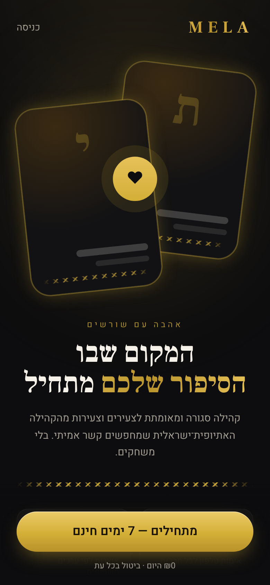
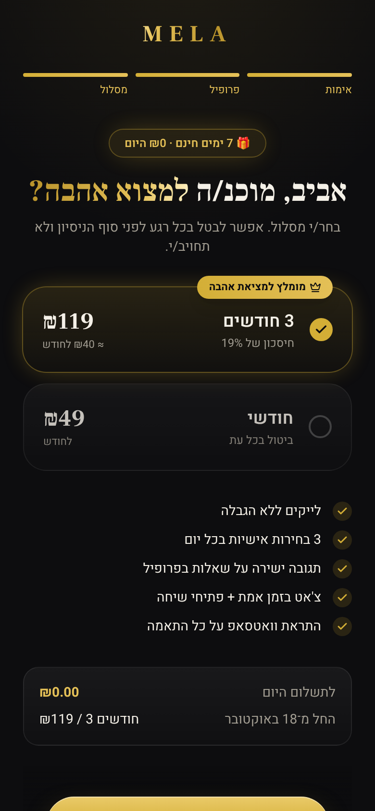
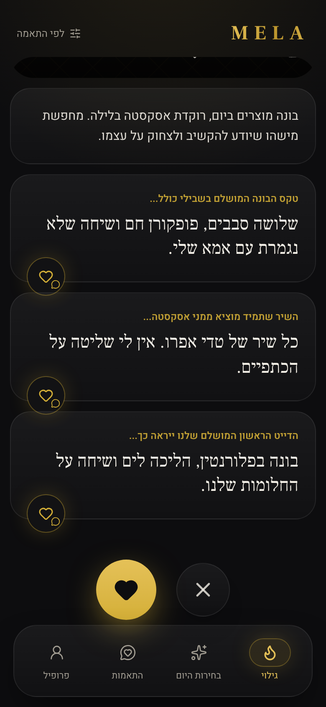
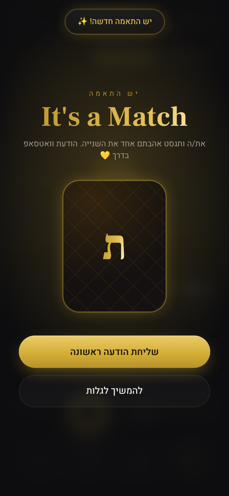
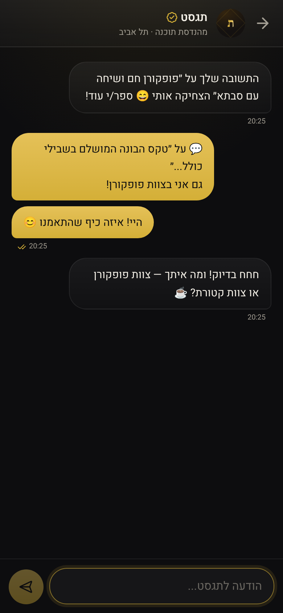
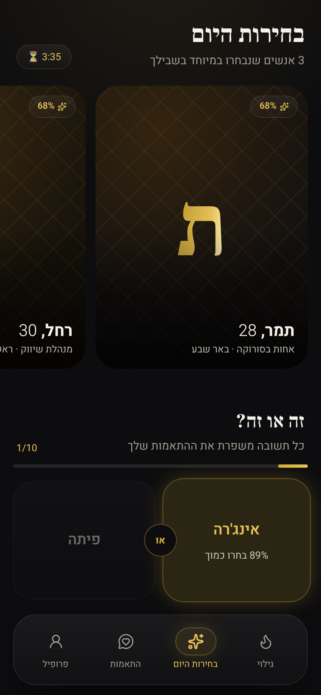

# MELA — אהבה עם שורשים

A mobile-first, Hebrew (RTL) dating web app for young Ethiopian-Israeli professionals looking for serious relationships.
It has a dark luxury theme (charcoal and warm gold, glassmorphism, Frank Ruhl Libre + Heebo), swipe cards, cultural prompts,
daily picks, a "This or That" quiz, real-time chat, and a 7-day free trial checkout.

| Landing | Checkout | Discover | Match | Chat | Daily quiz |
|---|---|---|---|---|---|
|  |  |  |  |  |  |

## Quick start

```bash
npm install
npm run dev            # http://localhost:3000
```

Requires **Node 22.13+**. The app uses the built-in `node:sqlite`, so there are no native modules to compile and no database server.
On first start the database is created at `data/mela.db` and seeded with 14 verified demo members.

Sign up with any Israeli mobile number (e.g. `050-123-4567`). In development the OTP is shown on screen and printed in the server log.
After you finish your profile, a few demo members "like" you, so you'll get matches right away. Demo members also reply in chat.

```bash
npm test               # unit tests: OTP, match engine, daily picks, billing, WhatsApp webhook
npm run typecheck
npm run build && npm start
npm run db:reset       # delete the local DB (it re-seeds on next start)
```

## Stack

- **Next.js 16** (App Router, route handlers), **React 19**, **Tailwind CSS 4**, TypeScript, Zod validation
- **SQLite** via `node:sqlite` (WAL mode). The schema is in `src/lib/db.ts`
- **Auth**: phone + 6-digit OTP (hashed, 5-minute TTL, 5 attempts, 30-second resend throttle), then an HTTP-only signed JWT cookie (`jose`)
- **Real-time**: Server-Sent Events (`/api/stream`) on an in-process event bus. It carries messages, read receipts, typing and new matches

## Data model

| Table | Fields |
|---|---|
| `users` | email, phone_number, full_name, age, gender, location, bio, occupation, photos (JSON array), is_verified, created_at, plus `seeking` (whom they want to see) and `is_demo` |
| `subscriptions` | user_id, plan_type (`monthly_49` / `quarterly_119`), status (`trialing` / `active` / `canceled` / `past_due`), trial_ends_at, current_period_end |
| `cultural_prompts` | user_id, question_key, answer_text |
| `matches` | user_1_id (who liked first), user_2_id, status (`pending` / `matched` / `rejected`), created_at, matched_at |
| `messages` | match_id, sender_id, text_content, is_read, sent_at |
| supporting | `otp_codes`, `quiz_answers`, `daily_picks`, `webhook_deliveries` |

A like creates a `pending` match. A like back flips it to `matched`. A comment on a prompt is stored as the first message of that match,
so the other person sees it once they match. Chat is only available for `matched` rows.

## Flow

1. `/onboarding/phone`: phone, then OTP
2. `/onboarding/profile`: up to 6 photos, basics, occupation, bio, and 2–3 cultural prompts (bunna, Sigd, family, Amharic word…)
3. `/onboarding/plan`: Monthly ₪49 or 3 months ₪119 ("recommended for finding love"). Both start with **7 days free, ₪0 today**
4. App (bottom bar): **Discover**, **Daily Picks** (3/day plus the quiz), **Matches** (likes you, new matches, chats), **Profile** (subscription, cancel/resume, edit)

Paid areas are gated server-side. Without an active trial or subscription the API returns 402 and the page sends the member to checkout.
A canceled subscription keeps access until the period ends. A returning member does not get a second free trial.

## WhatsApp match trigger

Every mutual match calls `triggerMatchWhatsApp` (`src/lib/whatsapp.ts`). Configure one or both channels:

- **Webhook** (`WHATSAPP_WEBHOOK_URL`): `POST` JSON `{ event: "match.created", match_id, matched_at, users: [{ id, full_name, phone_number }] }`
  with `X-Mela-Signature: sha256=<HMAC of body with WHATSAPP_WEBHOOK_SECRET>`. Plug in n8n, Make, Zapier or Twilio.
- **WhatsApp Cloud API** (`WHATSAPP_CLOUD_TOKEN` + `WHATSAPP_PHONE_NUMBER_ID`): sends the approved template `WHATSAPP_TEMPLATE_NAME`
  (Hebrew, one body parameter: the other person's name) to both members.

Every attempt is recorded in `webhook_deliveries`. With nothing configured, the payload is logged to the console.

## Deploying

See **[DEPLOY.md](DEPLOY.md)**. It covers Railway and Render step by step, using the included `Dockerfile`, `railway.json` and `render.yaml`.

## Before going to production

Copy `.env.example` to `.env` and set it up. Several pieces are intentionally stubbed behind small seams:

- **Payments**: `BILLING_PROVIDER=mock` activates the trial without collecting a card. Wire a real PSP (Stripe, Tranzila, Cardcom…) in
  `src/lib/billing.ts`: tokenize the card at checkout, charge at `trial_ends_at`, and update `status` from the provider's webhook.
- **SMS**: set `SMS_PROVIDER=twilio` and the Twilio credentials. The console provider never shows the code when `NODE_ENV=production`.
- **Secrets**: `SESSION_SECRET` (32+ chars) is required. The server refuses to sign sessions without it in production.
- **Demo data**: set `MELA_SKIP_SEED=1` and `MELA_DEMO_MODE=off` so there are no demo members, fake likes or auto-replies.
- **Photos**: uploads go to `$MELA_DATA_DIR/uploads` (local disk / volume). For anything beyond one server, move them to S3/R2/Cloudinary in `src/app/api/photos`.
- **Scale-out**: SQLite and the in-process SSE bus assume a single Node instance on a persistent disk (a VPS, Fly.io, Railway).
  For multiple instances or serverless, move to Postgres and Redis pub/sub. The data access is concentrated in `src/lib/*` for that reason.
- **Photography**: the demo members and the landing hero use gold monogram cards. Add licensed photos of Habesha / Ethiopian-Israeli
  models in `src/lib/demo-photos.ts` (`DEMO_PHOTOS`, `HERO_PHOTOS`).
- **Still missing**: report/block, moderation, and terms/privacy pages.
